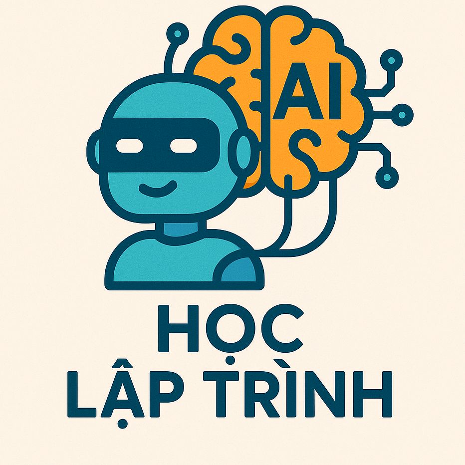
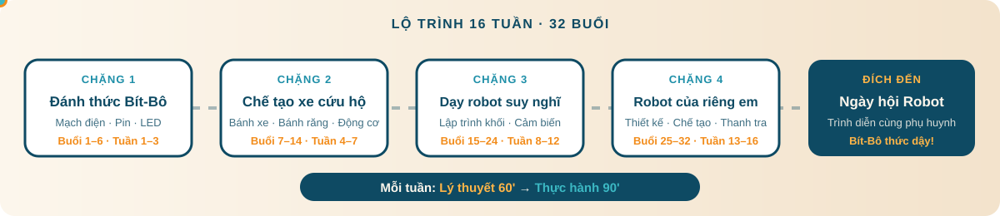
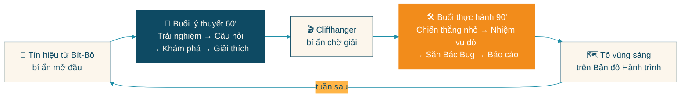
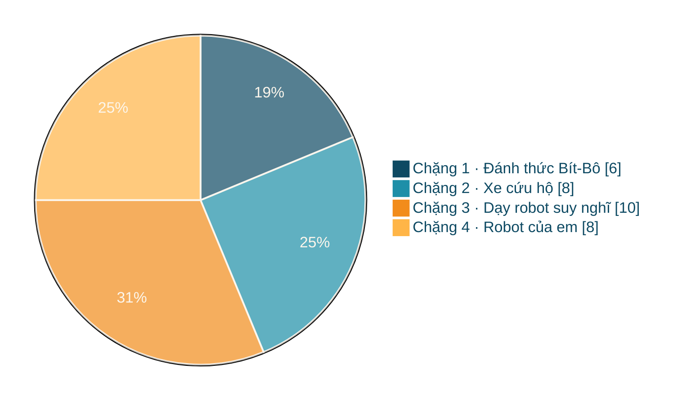
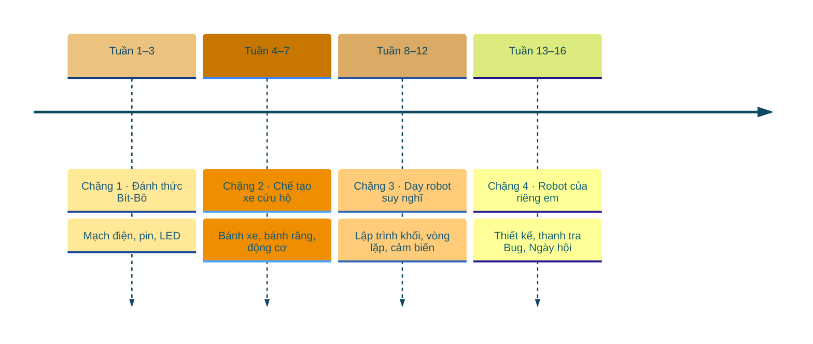
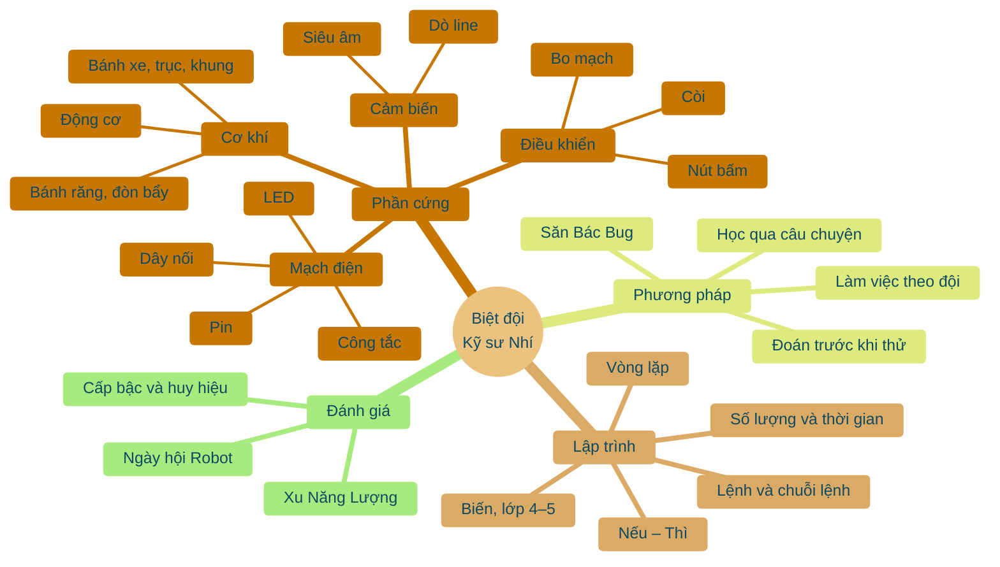

<div align="center">



<br/>



# 🤖 Biệt đội Kỹ sư Nhí: Cứu Hành tinh Bít-Bô

**Giáo trình robotics 32 buổi cho học sinh tiểu học chưa biết gì về robot: mỗi nhiệm vụ gồm một buổi lý thuyết và một buổi thực hành, dẫn dắt bằng câu chuyện giải cứu hành tinh Bít-Bô.**

    

    

</div>

> [!IMPORTANT]
> **Tài liệu độc quyền – All Rights Reserved.** Toàn bộ giáo trình, bài giảng, phiếu bài tập và hình ảnh trong repository này thuộc bản quyền của **Trương Tấn Nghĩa · AI Học Lập Trình**. Nghiêm cấm sao chép, chỉnh sửa, phân phối hoặc dùng cho mục đích thương mại khi chưa có văn bản cho phép. Xem [LICENSE](LICENSE).

## 📑 Mục lục

- [✨ Điểm nổi bật](#-điểm-nổi-bật)
- [🗺️ Lộ trình khóa học](#️-lộ-trình-khóa-học)
- [📊 Sơ đồ chương trình](#-sơ-đồ-chương-trình)
- [📚 Danh sách 32 buổi](#-danh-sách-32-buổi)
- [🚀 Cách sử dụng](#-cách-sử-dụng)
- [🗂️ Cấu trúc thư mục](#️-cấu-trúc-thư-mục)
- [✍️ Tác giả](#️-tác-giả)

## ✨ Điểm nổi bật

<table>
<tr>
<td width="33%" valign="top">

### 🧭 Học qua phiêu lưu
Bác Bug làm hành tinh Bít-Bô "ngủ đông". Mỗi nhiệm vụ đánh thức thêm một vùng trên Bản đồ Hành trình.

</td>
<td width="33%" valign="top">

### ⚖️ Lý thuyết + Thực hành
16 nhiệm vụ, mỗi nhiệm vụ có 1 buổi lý thuyết 60 phút và 1 buổi thực hành 90 phút.

</td>
<td width="33%" valign="top">

### 🔌 12 linh kiện có biệt danh
Pin là "Bình sữa năng lượng", cảm biến siêu âm là "Dơi". Mỗi linh kiện đi qua 5 bước Nhìn – Sờ – Đoán – Thử – Kể.

</td>
</tr>
<tr>
<td width="33%" valign="top">

### 🧩 Bậc thang lập trình 8 nấc
Từ "lệnh rõ ràng" (nấc 0) đến "kết hợp và tự thiết kế" (nấc 7). Lập trình bằng khối màu, không cần đánh chữ.

</td>
<td width="33%" valign="top">

### 🐛 Lỗi là "Bác Bug"
Trẻ không sợ sai: tự tìm và sửa lỗi là được thưởng Xu Năng Lượng.

</td>
<td width="33%" valign="top">

### 📦 Trọn bộ tài liệu mỗi buổi
Giáo án, bài giảng chi tiết, phiếu bài tập, hướng dẫn demo và chương trình mẫu.

</td>
</tr>
</table>

## 🗺️ Lộ trình khóa học



Mỗi tuần học một nhiệm vụ theo cùng một nhịp:



## 📊 Sơ đồ chương trình

<table>
<tr>
<td width="50%" valign="top">

**Số buổi theo chặng**



</td>
<td width="50%" valign="top">

**4 chặng trong 16 tuần**



</td>
</tr>
</table>

**Bản đồ kiến thức**



**Bậc thang lập trình 8 nấc** – cả đội chỉ lên nấc mới khi làm được nấc cũ mà không cần gợi ý.

```mermaid
%%{init: {'theme':'base','themeVariables':{'primaryColor':'#FCF6EC','primaryTextColor':'#0E4A63','primaryBorderColor':'#0E4A63','lineColor':'#1E8FA8','secondaryColor':'#FFB547','tertiaryColor':'#F3E3CC','fontFamily':'Segoe UI, Arial'}}}%%
stateDiagram-v2
    direction LR
    [*] --> N0
    N0: Nấc 0 · Lệnh rõ ràng
    N1: Nấc 1 · Một lệnh một việc
    N2: Nấc 2 · Chuỗi lệnh
    N3: Nấc 3 · Số lượng, thời gian
    N4: Nấc 4 · Vòng lặp
    N5: Nấc 5 · Nếu – Thì
    N6: Nấc 6 · Biến (lớp 4–5)
    N7: Nấc 7 · Tự thiết kế
    N0 --> N1 : buổi 3
    N1 --> N2 : buổi 11
    N2 --> N3 : buổi 17
    N3 --> N4 : buổi 19
    N4 --> N5 : buổi 21
    N5 --> N6 : buổi 25
    N5 --> N7 : lớp 1–3
    N6 --> N7
    N7 --> [*] : Ngày hội
```



## 📚 Danh sách 32 buổi

<details>
<summary><b>Bấm để xem bảng 32 buổi kèm link tài liệu</b></summary>

| Tuần | Buổi | Loại | Tên bài | Tài liệu |
| :---: | :---: | --- | --- | --- |
| 1 | 1 | 🧠 Lý thuyết | Robot là gì? | [Giáo án](Buoi01_LT_Robot-La-Gi/Tai-Lieu/Buoi01_Giao-An.md) · [Bài giảng](Buoi01_LT_Robot-La-Gi/Tai-Lieu/Buoi01_Bai-Giang.md) · [Phiếu](Buoi01_LT_Robot-La-Gi/Bai-Tap/Buoi01_Phieu-Bai-Tap.md) · [Demo](Buoi01_LT_Robot-La-Gi/Demo/Buoi01_Huong-Dan-Demo.md) |
| 1 | 2 | 🛠️ Thực hành | "Bạn là robot" tìm kho báu | [Giáo án](Buoi02_TH_Ban-La-Robot-Tim-Kho-Bau/Tai-Lieu/Buoi02_Giao-An.md) · [Bài giảng](Buoi02_TH_Ban-La-Robot-Tim-Kho-Bau/Tai-Lieu/Buoi02_Bai-Giang.md) · [Phiếu](Buoi02_TH_Ban-La-Robot-Tim-Kho-Bau/Bai-Tap/Buoi02_Phieu-Bai-Tap.md) · [Demo](Buoi02_TH_Ban-La-Robot-Tim-Kho-Bau/Demo/Buoi02_Huong-Dan-Demo.md) |
| 2 | 3 | 🧠 Lý thuyết | Giác quan – Bộ não – Tay chân | [Giáo án](Buoi03_LT_Giac-Quan-Bo-Nao-Tay-Chan/Tai-Lieu/Buoi03_Giao-An.md) · [Bài giảng](Buoi03_LT_Giac-Quan-Bo-Nao-Tay-Chan/Tai-Lieu/Buoi03_Bai-Giang.md) · [Phiếu](Buoi03_LT_Giac-Quan-Bo-Nao-Tay-Chan/Bai-Tap/Buoi03_Phieu-Bai-Tap.md) · [Demo](Buoi03_LT_Giac-Quan-Bo-Nao-Tay-Chan/Demo/Buoi03_Huong-Dan-Demo.md) |
| 2 | 4 | 🛠️ Thực hành | Làm quen dây nối và công tắc | [Giáo án](Buoi04_TH_Lam-Quen-Day-Noi-Cong-Tac/Tai-Lieu/Buoi04_Giao-An.md) · [Bài giảng](Buoi04_TH_Lam-Quen-Day-Noi-Cong-Tac/Tai-Lieu/Buoi04_Bai-Giang.md) · [Phiếu](Buoi04_TH_Lam-Quen-Day-Noi-Cong-Tac/Bai-Tap/Buoi04_Phieu-Bai-Tap.md) · [Demo](Buoi04_TH_Lam-Quen-Day-Noi-Cong-Tac/Demo/Buoi04_Huong-Dan-Demo.md) |
| 3 | 5 | 🧠 Lý thuyết | Mạch kín và mạch hở | [Giáo án](Buoi05_LT_Mach-Kin-Mach-Ho/Tai-Lieu/Buoi05_Giao-An.md) · [Bài giảng](Buoi05_LT_Mach-Kin-Mach-Ho/Tai-Lieu/Buoi05_Bai-Giang.md) · [Phiếu](Buoi05_LT_Mach-Kin-Mach-Ho/Bai-Tap/Buoi05_Phieu-Bai-Tap.md) · [Demo](Buoi05_LT_Mach-Kin-Mach-Ho/Demo/Buoi05_Huong-Dan-Demo.md) |
| 3 | 6 | 🛠️ Thực hành | Thám tử mạch điện | [Giáo án](Buoi06_TH_Tham-Tu-Mach-Dien/Tai-Lieu/Buoi06_Giao-An.md) · [Bài giảng](Buoi06_TH_Tham-Tu-Mach-Dien/Tai-Lieu/Buoi06_Bai-Giang.md) · [Phiếu](Buoi06_TH_Tham-Tu-Mach-Dien/Bai-Tap/Buoi06_Phieu-Bai-Tap.md) · [Demo](Buoi06_TH_Tham-Tu-Mach-Dien/Demo/Buoi06_Huong-Dan-Demo.md) |
| 4 | 7 | 🧠 Lý thuyết | Vì sao bánh xe giúp di chuyển dễ? | [Giáo án](Buoi07_LT_Vi-Sao-Banh-Xe-Giup-Di-Chuyen/Tai-Lieu/Buoi07_Giao-An.md) · [Bài giảng](Buoi07_LT_Vi-Sao-Banh-Xe-Giup-Di-Chuyen/Tai-Lieu/Buoi07_Bai-Giang.md) · [Phiếu](Buoi07_LT_Vi-Sao-Banh-Xe-Giup-Di-Chuyen/Bai-Tap/Buoi07_Phieu-Bai-Tap.md) · [Demo](Buoi07_LT_Vi-Sao-Banh-Xe-Giup-Di-Chuyen/Demo/Buoi07_Huong-Dan-Demo.md) |
| 4 | 8 | 🛠️ Thực hành | Lắp khung xe đầu tiên | [Giáo án](Buoi08_TH_Lap-Khung-Xe/Tai-Lieu/Buoi08_Giao-An.md) · [Bài giảng](Buoi08_TH_Lap-Khung-Xe/Tai-Lieu/Buoi08_Bai-Giang.md) · [Phiếu](Buoi08_TH_Lap-Khung-Xe/Bai-Tap/Buoi08_Phieu-Bai-Tap.md) · [Demo](Buoi08_TH_Lap-Khung-Xe/Demo/Buoi08_Huong-Dan-Demo.md) |
| 5 | 9 | 🧠 Lý thuyết | Bánh răng và đòn bẩy | [Giáo án](Buoi09_LT_Banh-Rang-Va-Don-Bay/Tai-Lieu/Buoi09_Giao-An.md) · [Bài giảng](Buoi09_LT_Banh-Rang-Va-Don-Bay/Tai-Lieu/Buoi09_Bai-Giang.md) · [Phiếu](Buoi09_LT_Banh-Rang-Va-Don-Bay/Bai-Tap/Buoi09_Phieu-Bai-Tap.md) · [Demo](Buoi09_LT_Banh-Rang-Va-Don-Bay/Demo/Buoi09_Huong-Dan-Demo.md) |
| 5 | 10 | 🛠️ Thực hành | Cơ cấu bánh răng của đội | [Giáo án](Buoi10_TH_Co-Cau-Banh-Rang/Tai-Lieu/Buoi10_Giao-An.md) · [Bài giảng](Buoi10_TH_Co-Cau-Banh-Rang/Tai-Lieu/Buoi10_Bai-Giang.md) · [Phiếu](Buoi10_TH_Co-Cau-Banh-Rang/Bai-Tap/Buoi10_Phieu-Bai-Tap.md) · [Demo](Buoi10_TH_Co-Cau-Banh-Rang/Demo/Buoi10_Huong-Dan-Demo.md) |
| 6 | 11 | 🧠 Lý thuyết | Động cơ – cơ bắp của robot | [Giáo án](Buoi11_LT_Dong-Co-Co-Bap-Cua-Robot/Tai-Lieu/Buoi11_Giao-An.md) · [Bài giảng](Buoi11_LT_Dong-Co-Co-Bap-Cua-Robot/Tai-Lieu/Buoi11_Bai-Giang.md) · [Phiếu](Buoi11_LT_Dong-Co-Co-Bap-Cua-Robot/Bai-Tap/Buoi11_Phieu-Bai-Tap.md) · [Demo](Buoi11_LT_Dong-Co-Co-Bap-Cua-Robot/Demo/Buoi11_Huong-Dan-Demo.md) |
| 6 | 12 | 🛠️ Thực hành | Lắp động cơ, xe tự chạy | [Giáo án](Buoi12_TH_Lap-Dong-Co-Xe-Tu-Chay/Tai-Lieu/Buoi12_Giao-An.md) · [Bài giảng](Buoi12_TH_Lap-Dong-Co-Xe-Tu-Chay/Tai-Lieu/Buoi12_Bai-Giang.md) · [Phiếu](Buoi12_TH_Lap-Dong-Co-Xe-Tu-Chay/Bai-Tap/Buoi12_Phieu-Bai-Tap.md) · [Demo](Buoi12_TH_Lap-Dong-Co-Xe-Tu-Chay/Demo/Buoi12_Huong-Dan-Demo.md) |
| 7 | 13 | 🧠 Lý thuyết | Làm sao cho xe tốt hơn? | [Giáo án](Buoi13_LT_Lam-Sao-Cho-Xe-Tot-Hon/Tai-Lieu/Buoi13_Giao-An.md) · [Bài giảng](Buoi13_LT_Lam-Sao-Cho-Xe-Tot-Hon/Tai-Lieu/Buoi13_Bai-Giang.md) · [Phiếu](Buoi13_LT_Lam-Sao-Cho-Xe-Tot-Hon/Bai-Tap/Buoi13_Phieu-Bai-Tap.md) · [Demo](Buoi13_LT_Lam-Sao-Cho-Xe-Tot-Hon/Demo/Buoi13_Huong-Dan-Demo.md) |
| 7 | 14 | 🛠️ Thực hành | Grand Prix Bít-Bô | [Giáo án](Buoi14_TH_Grand-Prix-Bit-Bo/Tai-Lieu/Buoi14_Giao-An.md) · [Bài giảng](Buoi14_TH_Grand-Prix-Bit-Bo/Tai-Lieu/Buoi14_Bai-Giang.md) · [Phiếu](Buoi14_TH_Grand-Prix-Bit-Bo/Bai-Tap/Buoi14_Phieu-Bai-Tap.md) · [Demo](Buoi14_TH_Grand-Prix-Bit-Bo/Demo/Buoi14_Huong-Dan-Demo.md) |
| 8 | 15 | 🧠 Lý thuyết | Thuật toán là công thức | [Giáo án](Buoi15_LT_Thuat-Toan-La-Cong-Thuc/Tai-Lieu/Buoi15_Giao-An.md) · [Bài giảng](Buoi15_LT_Thuat-Toan-La-Cong-Thuc/Tai-Lieu/Buoi15_Bai-Giang.md) · [Phiếu](Buoi15_LT_Thuat-Toan-La-Cong-Thuc/Bai-Tap/Buoi15_Phieu-Bai-Tap.md) · [Demo](Buoi15_LT_Thuat-Toan-La-Cong-Thuc/Demo/Buoi15_Huong-Dan-Demo.md) |
| 8 | 16 | 🛠️ Thực hành | Làm quen bo mạch, săn Bug trên giấy | [Giáo án](Buoi16_TH_Lam-Quen-Bo-Mach-San-Bug/Tai-Lieu/Buoi16_Giao-An.md) · [Bài giảng](Buoi16_TH_Lam-Quen-Bo-Mach-San-Bug/Tai-Lieu/Buoi16_Bai-Giang.md) · [Phiếu](Buoi16_TH_Lam-Quen-Bo-Mach-San-Bug/Bai-Tap/Buoi16_Phieu-Bai-Tap.md) · [Demo](Buoi16_TH_Lam-Quen-Bo-Mach-San-Bug/Demo/Buoi16_Huong-Dan-Demo.md) |
| 9 | 17 | 🧠 Lý thuyết | Lập trình bằng khối màu | [Giáo án](Buoi17_LT_Lap-Trinh-Bang-Khoi-Mau/Tai-Lieu/Buoi17_Giao-An.md) · [Bài giảng](Buoi17_LT_Lap-Trinh-Bang-Khoi-Mau/Tai-Lieu/Buoi17_Bai-Giang.md) · [Phiếu](Buoi17_LT_Lap-Trinh-Bang-Khoi-Mau/Bai-Tap/Buoi17_Phieu-Bai-Tap.md) · [Demo](Buoi17_LT_Lap-Trinh-Bang-Khoi-Mau/Demo/Buoi17_Huong-Dan-Demo.md) |
| 9 | 18 | 🛠️ Thực hành | Đưa xe tới kho báu | [Giáo án](Buoi18_TH_Dua-Xe-Toi-Kho-Bau/Tai-Lieu/Buoi18_Giao-An.md) · [Bài giảng](Buoi18_TH_Dua-Xe-Toi-Kho-Bau/Tai-Lieu/Buoi18_Bai-Giang.md) · [Phiếu](Buoi18_TH_Dua-Xe-Toi-Kho-Bau/Bai-Tap/Buoi18_Phieu-Bai-Tap.md) · [Demo](Buoi18_TH_Dua-Xe-Toi-Kho-Bau/Demo/Buoi18_Huong-Dan-Demo.md) |
| 10 | 19 | 🧠 Lý thuyết | Vòng lặp như điệp khúc | [Giáo án](Buoi19_LT_Vong-Lap-Nhu-Diep-Khuc/Tai-Lieu/Buoi19_Giao-An.md) · [Bài giảng](Buoi19_LT_Vong-Lap-Nhu-Diep-Khuc/Tai-Lieu/Buoi19_Bai-Giang.md) · [Phiếu](Buoi19_LT_Vong-Lap-Nhu-Diep-Khuc/Bai-Tap/Buoi19_Phieu-Bai-Tap.md) · [Demo](Buoi19_LT_Vong-Lap-Nhu-Diep-Khuc/Demo/Buoi19_Huong-Dan-Demo.md) |
| 10 | 20 | 🛠️ Thực hành | Xe chạy hình vuông, đèn nhạc theo vòng lặp | [Giáo án](Buoi20_TH_Xe-Chay-Hinh-Vuong/Tai-Lieu/Buoi20_Giao-An.md) · [Bài giảng](Buoi20_TH_Xe-Chay-Hinh-Vuong/Tai-Lieu/Buoi20_Bai-Giang.md) · [Phiếu](Buoi20_TH_Xe-Chay-Hinh-Vuong/Bai-Tap/Buoi20_Phieu-Bai-Tap.md) · [Demo](Buoi20_TH_Xe-Chay-Hinh-Vuong/Demo/Buoi20_Huong-Dan-Demo.md) |
| 11 | 21 | 🧠 Lý thuyết | Cảm biến siêu âm và Nếu – Thì | [Giáo án](Buoi21_LT_Cam-Bien-Sieu-Am-Va-Neu-Thi/Tai-Lieu/Buoi21_Giao-An.md) · [Bài giảng](Buoi21_LT_Cam-Bien-Sieu-Am-Va-Neu-Thi/Tai-Lieu/Buoi21_Bai-Giang.md) · [Phiếu](Buoi21_LT_Cam-Bien-Sieu-Am-Va-Neu-Thi/Bai-Tap/Buoi21_Phieu-Bai-Tap.md) · [Demo](Buoi21_LT_Cam-Bien-Sieu-Am-Va-Neu-Thi/Demo/Buoi21_Huong-Dan-Demo.md) |
| 11 | 22 | 🛠️ Thực hành | Xe tự dừng trước vật cản | [Giáo án](Buoi22_TH_Xe-Tu-Dung-Truoc-Vat-Can/Tai-Lieu/Buoi22_Giao-An.md) · [Bài giảng](Buoi22_TH_Xe-Tu-Dung-Truoc-Vat-Can/Tai-Lieu/Buoi22_Bai-Giang.md) · [Phiếu](Buoi22_TH_Xe-Tu-Dung-Truoc-Vat-Can/Bai-Tap/Buoi22_Phieu-Bai-Tap.md) · [Demo](Buoi22_TH_Xe-Tu-Dung-Truoc-Vat-Can/Demo/Buoi22_Huong-Dan-Demo.md) |
| 12 | 23 | 🧠 Lý thuyết | Cảm biến dò line | [Giáo án](Buoi23_LT_Cam-Bien-Do-Line/Tai-Lieu/Buoi23_Giao-An.md) · [Bài giảng](Buoi23_LT_Cam-Bien-Do-Line/Tai-Lieu/Buoi23_Bai-Giang.md) · [Phiếu](Buoi23_LT_Cam-Bien-Do-Line/Bai-Tap/Buoi23_Phieu-Bai-Tap.md) · [Demo](Buoi23_LT_Cam-Bien-Do-Line/Demo/Buoi23_Huong-Dan-Demo.md) |
| 12 | 24 | 🛠️ Thực hành | Xe đi hết mê cung đen | [Giáo án](Buoi24_TH_Xe-Di-Het-Me-Cung/Tai-Lieu/Buoi24_Giao-An.md) · [Bài giảng](Buoi24_TH_Xe-Di-Het-Me-Cung/Tai-Lieu/Buoi24_Bai-Giang.md) · [Phiếu](Buoi24_TH_Xe-Di-Het-Me-Cung/Bai-Tap/Buoi24_Phieu-Bai-Tap.md) · [Demo](Buoi24_TH_Xe-Di-Het-Me-Cung/Demo/Buoi24_Huong-Dan-Demo.md) |
| 13 | 25 | 🧠 Lý thuyết | Từ ý tưởng đến thiết kế | [Giáo án](Buoi25_LT_Tu-Y-Tuong-Den-Thiet-Ke/Tai-Lieu/Buoi25_Giao-An.md) · [Bài giảng](Buoi25_LT_Tu-Y-Tuong-Den-Thiet-Ke/Tai-Lieu/Buoi25_Bai-Giang.md) · [Phiếu](Buoi25_LT_Tu-Y-Tuong-Den-Thiet-Ke/Bai-Tap/Buoi25_Phieu-Bai-Tap.md) · [Demo](Buoi25_LT_Tu-Y-Tuong-Den-Thiet-Ke/Demo/Buoi25_Huong-Dan-Demo.md) |
| 13 | 26 | 🛠️ Thực hành | Vẽ thiết kế, đăng ký bằng sáng chế | [Giáo án](Buoi26_TH_Ve-Thiet-Ke-Dang-Ky-Sang-Che/Tai-Lieu/Buoi26_Giao-An.md) · [Bài giảng](Buoi26_TH_Ve-Thiet-Ke-Dang-Ky-Sang-Che/Tai-Lieu/Buoi26_Bai-Giang.md) · [Phiếu](Buoi26_TH_Ve-Thiet-Ke-Dang-Ky-Sang-Che/Bai-Tap/Buoi26_Phieu-Bai-Tap.md) · [Demo](Buoi26_TH_Ve-Thiet-Ke-Dang-Ky-Sang-Che/Demo/Buoi26_Huong-Dan-Demo.md) |
| 14 | 27 | 🧠 Lý thuyết | Quy trình kỹ sư và Thanh tra Bug | [Giáo án](Buoi27_LT_Quy-Trinh-Ky-Su-Thanh-Tra-Bug/Tai-Lieu/Buoi27_Giao-An.md) · [Bài giảng](Buoi27_LT_Quy-Trinh-Ky-Su-Thanh-Tra-Bug/Tai-Lieu/Buoi27_Bai-Giang.md) · [Phiếu](Buoi27_LT_Quy-Trinh-Ky-Su-Thanh-Tra-Bug/Bai-Tap/Buoi27_Phieu-Bai-Tap.md) · [Demo](Buoi27_LT_Quy-Trinh-Ky-Su-Thanh-Tra-Bug/Demo/Buoi27_Huong-Dan-Demo.md) |
| 14 | 28 | 🛠️ Thực hành | Chế tạo và thanh tra lần 1 | [Giáo án](Buoi28_TH_Che-Tao-Thanh-Tra-Lan-1/Tai-Lieu/Buoi28_Giao-An.md) · [Bài giảng](Buoi28_TH_Che-Tao-Thanh-Tra-Lan-1/Tai-Lieu/Buoi28_Bai-Giang.md) · [Phiếu](Buoi28_TH_Che-Tao-Thanh-Tra-Lan-1/Bai-Tap/Buoi28_Phieu-Bai-Tap.md) · [Demo](Buoi28_TH_Che-Tao-Thanh-Tra-Lan-1/Demo/Buoi28_Huong-Dan-Demo.md) |
| 15 | 29 | 🧠 Lý thuyết | Giới thiệu robot của đội | [Giáo án](Buoi29_LT_Gioi-Thieu-Robot-Cua-Doi/Tai-Lieu/Buoi29_Giao-An.md) · [Bài giảng](Buoi29_LT_Gioi-Thieu-Robot-Cua-Doi/Tai-Lieu/Buoi29_Bai-Giang.md) · [Phiếu](Buoi29_LT_Gioi-Thieu-Robot-Cua-Doi/Bai-Tap/Buoi29_Phieu-Bai-Tap.md) · [Demo](Buoi29_LT_Gioi-Thieu-Robot-Cua-Doi/Demo/Buoi29_Huong-Dan-Demo.md) |
| 15 | 30 | 🛠️ Thực hành | Hoàn thiện robot, thanh tra lần 2, tổng duyệt | [Giáo án](Buoi30_TH_Hoan-Thien-Robot-Tong-Duyet/Tai-Lieu/Buoi30_Giao-An.md) · [Bài giảng](Buoi30_TH_Hoan-Thien-Robot-Tong-Duyet/Tai-Lieu/Buoi30_Bai-Giang.md) · [Phiếu](Buoi30_TH_Hoan-Thien-Robot-Tong-Duyet/Bai-Tap/Buoi30_Phieu-Bai-Tap.md) · [Demo](Buoi30_TH_Hoan-Thien-Robot-Tong-Duyet/Demo/Buoi30_Huong-Dan-Demo.md) |
| 16 | 31 | 🧠 Lý thuyết | Ôn tập và tự đánh giá | [Giáo án](Buoi31_LT_On-Tap-Va-Tu-Danh-Gia/Tai-Lieu/Buoi31_Giao-An.md) · [Bài giảng](Buoi31_LT_On-Tap-Va-Tu-Danh-Gia/Tai-Lieu/Buoi31_Bai-Giang.md) · [Phiếu](Buoi31_LT_On-Tap-Va-Tu-Danh-Gia/Bai-Tap/Buoi31_Phieu-Bai-Tap.md) · [Demo](Buoi31_LT_On-Tap-Va-Tu-Danh-Gia/Demo/Buoi31_Huong-Dan-Demo.md) |
| 16 | 32 | 🛠️ Thực hành | Ngày hội Giải cứu Bít-Bô | [Giáo án](Buoi32_TH_Ngay-Hoi-Giai-Cuu-Bit-Bo/Tai-Lieu/Buoi32_Giao-An.md) · [Bài giảng](Buoi32_TH_Ngay-Hoi-Giai-Cuu-Bit-Bo/Tai-Lieu/Buoi32_Bai-Giang.md) · [Phiếu](Buoi32_TH_Ngay-Hoi-Giai-Cuu-Bit-Bo/Bai-Tap/Buoi32_Phieu-Bai-Tap.md) · [Demo](Buoi32_TH_Ngay-Hoi-Giai-Cuu-Bit-Bo/Demo/Buoi32_Huong-Dan-Demo.md) |

</details>

<details>
<summary><b>12 linh kiện và biệt danh</b></summary>

| Linh kiện | Biệt danh | Học ở buổi |
| --- | --- | :---: |
| Dây nối | Con đường điện | 3–4 |
| Công tắc | Người gác cổng | 3–4 |
| Pin và hộp pin | Bình sữa năng lượng | 5–6 |
| Đèn LED | Đom đóm | 5–6 |
| Bánh xe, trục, khung | Đôi chân | 7–8 |
| Bánh răng, đòn bẩy | Anh em răng cưa, Bập bênh | 9–10 |
| Động cơ | Cơ bắp | 11–12 |
| Bo mạch điều khiển | Bộ não | 15–16 |
| Còi (buzzer) | Chú chim hót | 17–18 |
| Cảm biến siêu âm | Dơi | 21–22 |
| Cảm biến dò line | Mắt mèo | 23–24 |
| Nút bấm | Chuông cửa | 25–26 |

</details>

## 🚀 Cách sử dụng

Tài liệu viết bằng Markdown, không cần cài đặt hay biên dịch.

```powershell
# Windows · PowerShell
gh repo clone TruongTanNghia/giao-trinh-robotics-bit-bo
cd giao-trinh-robotics-bit-bo
code .
```

1. Đọc [Giao-Trinh-Tong.md](Giao-Trinh-Tong.md) để nắm toàn khóa: mục tiêu, phân phối chương trình, đánh giá, thiết bị.
2. Mở [Muc-Luc-32-Buoi.md](Muc-Luc-32-Buoi.md) để đi tới tài liệu từng buổi.
3. Trước mỗi buổi: đọc **Bài giảng** (lý thuyết, lời giảng mẫu), xem **Giáo án** (tiến trình theo phút), dựng **Demo**, in **Phiếu bài tập**.
4. Mở [khoa-hoc-robotics-bit-bo.html](khoa-hoc-robotics-bit-bo.html) bằng trình duyệt để xem bản giới thiệu khóa học có bản đồ tương tác.

> [!TIP]
> Trong VS Code, bấm `Ctrl+Shift+V` để xem Markdown dạng trang đẹp. Muốn in phiếu bài tập thành PDF, cài tiện ích **Markdown PDF** rồi chọn *Markdown PDF: Export (pdf)*.

> [!WARNING]
> Tên khối lệnh trong chương trình mẫu đang viết chung chung. Hãy đổi theo phần mềm lập trình khối và bộ kit robot mà lớp đang dùng. Luôn có Plan B không cần máy cho mỗi buổi thực hành.

## 🗂️ Cấu trúc thư mục

```text
📦 giao-trinh-robotics-bit-bo
├── 📄 README.md                         ← trang bạn đang đọc
├── 📘 Giao-Trinh-Tong.md                ← giáo trình đầy đủ 6 mục
├── 🧭 Muc-Luc-32-Buoi.md                ← mục lục, link tới từng buổi
├── 🌐 khoa-hoc-robotics-bit-bo.html     ← trang giới thiệu khóa học (bản gốc)
├── 🎨 assets/                           ← banner, sơ đồ, chữ ký, logo
├── 📁 Buoi01_LT_Robot-La-Gi/
│   ├── 📝 Bai-Tap/    Buoi01_Phieu-Bai-Tap.md   ← phiếu cho học sinh
│   ├── 💻 Colab/      README.md                 ← chương trình mẫu
│   ├── 🎬 Demo/       Buoi01_Huong-Dan-Demo.md  ← dựng màn mở đầu
│   └── 📚 Tai-Lieu/   Buoi01_Giao-An.md         ← tiến trình theo phút
│                      Buoi01_Bai-Giang.md       ← lý thuyết, lời giảng
├── 📁 Buoi02_TH_Ban-La-Robot-Tim-Kho-Bau/
├── ...
└── 📁 Buoi32_TH_Ngay-Hoi-Giai-Cuu-Bit-Bo/
```

| Thành phần | Số lượng | Trạng thái |
| --- | :---: | :---: |
| Giáo trình tổng | 1 |  |
| Giáo án | 32 |  |
| Bài giảng chi tiết | 32 |  |
| Phiếu bài tập | 32 |  |
| Hướng dẫn demo | 32 |  |
| Thư mục Colab (README) | 32 |  |
| Chương trình mẫu dạng khối | 10 buổi |  |

## ✍️ Tác giả

<div align="center">


### Trương Tấn Nghĩa

**AI Học Lập Trình** · 🔥 *Never give up* 🔥

<a href="https://github.com/TruongTanNghia"></a> <a href="https://nghia-dev-profile.vercel.app"></a> <a href="https://www.tiktok.com/@aihoclaptrinh"></a>

<br/><br/>


<sub>© 2026 Trương Tấn Nghĩa — AI Học Lập Trình. All Rights Reserved.</sub><br/>
<sub>Tài liệu riêng tư · Nghiêm cấm sao chép, phân phối khi chưa được phép.</sub>

</div>
